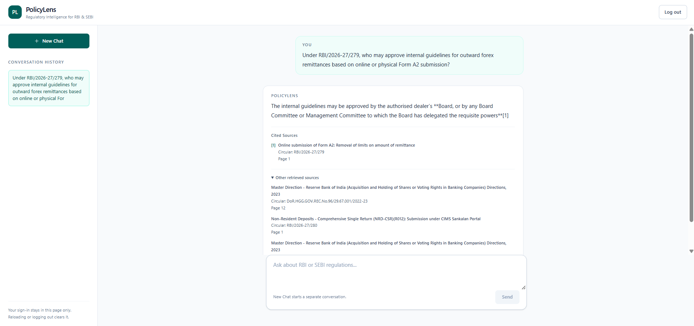
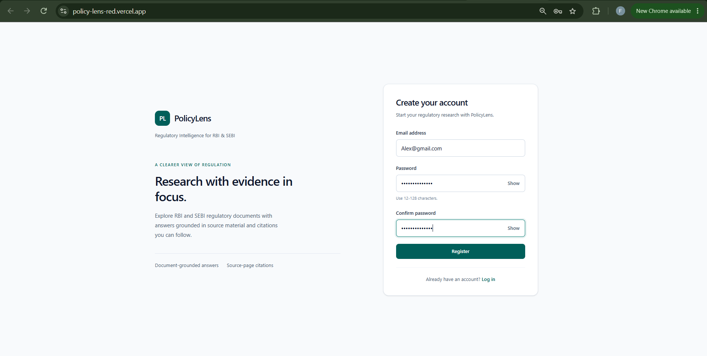
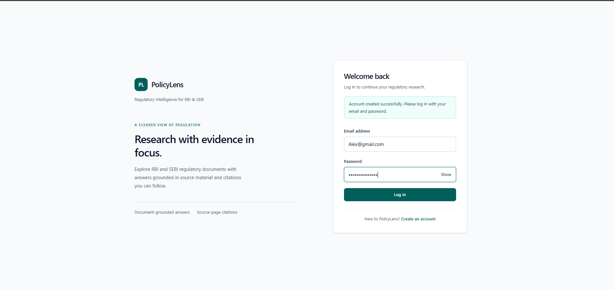
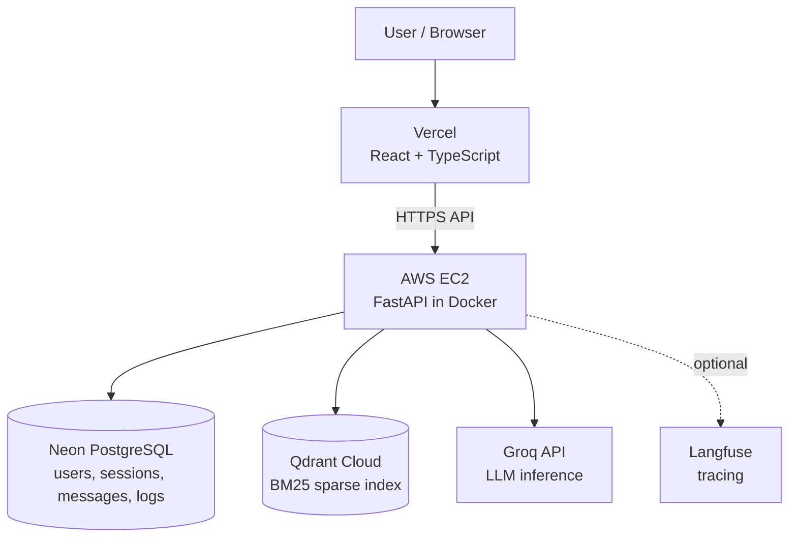
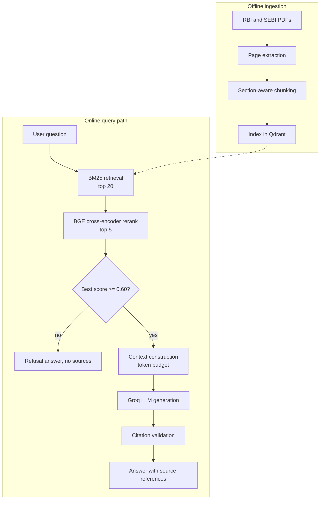

# PolicyLens

**Evidence-grounded question answering over RBI and SEBI regulatory documents, with page-level citations and a refusal gate for weak evidence.**

[GitHub repository](https://github.com/Faizan0602/PolicyLens) | [Live demo](https://policy-lens-red.vercel.app/)


## Overview

Regulatory research often means locating one operative clause inside long RBI and SEBI circulars. PolicyLens is a chat workspace where an authenticated user asks a question, receives an answer built only from retrieved document passages, and can inspect the circular and page behind every citation. Conversations are saved so research can continue across follow-up questions.

**Why RAG fits this domain.** Regulations change, answers must be traceable to a source page, and a fluent but unsupported answer is worse than no answer. Retrieval-augmented generation keeps the model tied to a fixed document corpus, and the pipeline refuses to answer when the retrieved evidence scores below a relevance threshold.

**How users interact with it.** Register, log in, ask a question about RBI or SEBI regulations, read the answer with its cited sources, and reopen earlier conversations from the sidebar.

**Engineering focus.** The project is organised around one question: does the right evidence reach the model? Retrieval is benchmarked against a golden set, candidates are reranked, citations are checked, and optional traces expose failures behind a fluent answer.

## Application Walkthrough

### Evidence-grounded answer with citations

<p align="center">
  
</p>

*The research workspace: a question about RBI/2026-27/279 receives an answer with a numbered citation. "Cited Sources" lists the circular and page the answer relies on, "Other retrieved sources" shows the remaining reranked chunks, and the sidebar holds saved conversations.*

### User authentication

<table>
  <tr>
    <td width="50%"></td>
    <td width="50%"></td>
  </tr>
  <tr>
    <td align="center"><sub><b>Registration</b> - email and a 12-128 character password</sub></td>
    <td align="center"><sub><b>Login</b> - JWT-authenticated access to private chat sessions</sub></td>
  </tr>
</table>

## Key Features

Each item below is implemented in the repository.

| Area | What is implemented | Where |
| --- | --- | --- |
| PDF ingestion | PDF page extraction with PyMuPDF, cleaning, table-of-contents page filtering and chunk validation | `src/policylens/ingestion/` |
| Chunking | Structure-aware recursive chunking using detected section headings, with canonical chunk metadata | `ingestion/chunker.py` |
| Retrieval | BM25 sparse retrieval from Qdrant, top 20 candidates, public documents only | `bm25.py`, `rag.py` |
| Reranking | `BAAI/bge-reranker-base` cross-encoder selects the final top 5 | `reranker.py` |
| Abstention | Refusal when the highest rerank score is below 0.60 | `reranker.py` |
| Generation | Groq `openai/gpt-oss-120b`, prompt v1, temperature 0, bounded prompt (7,680 tokens) and completion (1,024 tokens) | `rag.py`, `llm.py` |
| Citation check | Verifies that cited tags exist in the supplied sources | `citations.py` |
| Conversations | Saved sessions and messages; follow-ups use bounded history and fresh retrieval | `api/`, `db/` |
| Authentication | Argon2id password hashing, JWT access tokens, owner-scoped sessions | `api/auth.py` |
| Rate limiting | 10 chat requests per user per 60 seconds, with `Retry-After` | `api/dependencies.py` |
| Observability | Query log with per-stage latency, token usage and estimated cost; optional Langfuse tracing | `db/models.py`, `tracing.py` |
| Evaluation | Retrieval metrics (Hit@5, Recall@5, MRR), prompt comparison and partial RAGAS runs | `eval/` |

## System Architecture

PolicyLens runs as separately hosted services. The Vercel-hosted React frontend calls a FastAPI backend, which is packaged as a Docker image and deployed on AWS EC2. The backend uses managed external services for relational storage, retrieval and LLM inference.



| Component | Responsibility |
| --- | --- |
| Vercel frontend | Authentication forms, chat workspace, citation display, session history. Access token is kept in memory only. |
| FastAPI backend (EC2, Docker) | Auth, chat orchestration, retrieval, reranking, abstention gate, citation check, query logging. Reranker models run on CPU inside the backend container. |
| Neon PostgreSQL | Users, chat sessions, messages, document metadata, feedback table and query logs. Schema managed with Alembic. |
| Qdrant Cloud | Chunk storage and BM25 sparse search (collection `policylens_bm25`). |
| Groq API | Answer generation with `openai/gpt-oss-120b`. |
| Langfuse (optional) | Stage traces; disabled by default, and chat continues if tracing fails. |

## RAG Pipeline Architecture

The production query path is **BM25 retrieval followed by cross-encoder reranking**. It does not fuse dense and sparse scores at query time. A native dense + BM25 RRF hybrid was built and benchmarked, but it tied the BM25 + reranker quality with more components, so it is not the selected pipeline.



Follow-up questions use bounded conversation history and a fresh retrieval pass. Details: [RAG workflow and security notes](docs/rag_notes.md).

## Retrieval Evaluation and Benchmarks

The [golden set](data/eval/golden.jsonl) has 60 questions: 48 development (41 answerable, 7 unanswerable) and 12 frozen hold-out (10 answerable, 2 unanswerable). The hold-out set was evaluated once for the final retrieval configuration and not used for later selection.

| Measurement | Result | Sample |
| --- | ---: | --- |
| Dense retrieval Recall@5 | 85.61% | 41 answerable development questions |
| BM25 + BGE reranker Recall@5 (selected) | 92.93% | Same 41 questions |
| Frozen hold-out Hit@5 | 80% (8/10) | 10 answerable hold-out questions |
| Manual answer review | 12 full, 7 partial, 1 failure | 20 development questions, human review |

Full comparison on the 41 development questions:

| Method | Hit@5 | Recall@5 | MRR |
| --- | ---: | ---: | ---: |
| Dense (BGE-small) | 0.9268 | 0.8561 | 0.8862 |
| BM25 | 0.9512 | 0.9049 | 0.8943 |
| Native hybrid RRF (dense + BM25) | 0.9512 | 0.8927 | 0.8476 |
| **BM25 + BGE reranker (selected)** | 0.9512 | **0.9293** | 0.8951 |
| Hybrid + BGE reranker | 0.9512 | 0.9293 | 0.8951 |

**How to read these numbers**

- The 7.32 percentage-point Recall@5 gain (85.61% to 92.93%) is a **retrieval** result: it measures how many gold pages appear in the final top 5. It is not a claim of equivalent improvement in answer accuracy, because a retrieved page can still lack the clause needed to answer.
- The samples are small (41 development, 10 hold-out, 20 manually reviewed). The hold-out result carries substantial uncertainty, and the manual-review questions were selected from the development set.
- The 0.60 gate was tested on 7 unanswerable development questions: 4 correctly refused, 3 missed. Rerank scores are not calibrated confidence.
- RAGAS evaluation is partial (a 5-question subset per judge) and the full run is paused because of API limits. The judge model is not independent of the generator in the Groq run, so these scores are not pooled or headlined here.
- Measured request latency: p50 8.23 s, p95 16.66 s over 24 sequential requests, with reranking dominant (p50 5.38 s). This is not a concurrency test or SLA.

Full methodology and artifacts: [Final benchmark report](docs/benchmarks/FINAL_BENCHMARK_REPORT.md).

## Technology Stack

| Category | Technologies |
| --- | --- |
| Languages | Python, TypeScript |
| Backend | FastAPI, SQLAlchemy, Alembic, Pydantic, Argon2, PyJWT, Docker |
| Generative AI / LLM | Groq (`openai/gpt-oss-120b`), LangChain Core (LCEL), versioned prompt templates |
| RAG and retrieval | BM25 sparse retrieval, section-aware chunking, PyMuPDF, Qdrant client |
| Embeddings and reranking | Sentence Transformers, BGE-small embeddings (dense baseline), `BAAI/bge-reranker-base` cross-encoder |
| Databases | Neon PostgreSQL, Qdrant Cloud |
| Frontend | React 19, TypeScript, Vite, Tailwind CSS |
| Cloud and deployment | Vercel (frontend), AWS EC2 (backend container) |
| Evaluation and observability | Hit@5 / Recall@5 / MRR scripts, RAGAS (partial), Langfuse (optional), query-log latency and cost reporting, pytest, Ruff |

## Engineering Challenges and Decisions

| Decision or problem | What was done | Evidence |
| --- | --- | --- |
| Retrieval quality | Compared dense, BM25, native RRF hybrid and reranked variants on a fixed golden set. BM25 + reranker was selected; hybrid reranking tied quality with more components. | [Benchmark report](docs/benchmarks/FINAL_BENCHMARK_REPORT.md) |
| Candidate depth | Depth 20 beat 10 on recall; depth 30 tied recall but worsened MRR and latency. | [Retrieval notes](docs/retrieval_notes.md) |
| Evidence-based abstention | Rerank score gate at 0.60 refuses weak-evidence questions before the LLM is called. Measured on development and hold-out sets; known to miss some unsupported questions. | [Benchmark report](docs/benchmarks/FINAL_BENCHMARK_REPORT.md) |
| Failure diagnosis (G003) | A needed page was BM25 rank 8 and reranker rank 12, so it never reached generation. A metadata-enrichment experiment fixed it but regressed five other questions, so it was **not deployed**. | [Experiment details](docs/benchmarks/FINAL_BENCHMARK_REPORT.md#metadata-enrichment-experiment-not-deployed) |
| Citation parsing | Correct answers were missed by the parser because of whitespace variants in citation tags. The regex was fixed and manually verified; historical benchmark labels were left unchanged. | [Golden-set review](docs/benchmarks/2026-10-27-golden-set.md) |
| Abstention contract | Not-found text could be returned with `abstained=false`. Final-response normalization was added and covered by offline tests. A successful post-fix end-to-end API retest is still unverified. | [Benchmark report](docs/benchmarks/FINAL_BENCHMARK_REPORT.md) |
| Authentication and isolation | Argon2id password hashing, JWT access tokens, and sessions scoped to their owner. | [RAG notes](docs/rag_notes.md) |
| Latency and cost visibility | Each request logs per-stage latency, token counts and an estimated cost to PostgreSQL, which exposed reranking as the main latency contributor. | [Query-log report script](scripts/query_log_report.py) |


## Local Setup

The commands below run the whole stack locally (Docker Compose PostgreSQL and Qdrant); the hosted deployment uses Neon and Qdrant Cloud instead. Prerequisites: Python 3.10+, Vite-compatible Node.js (for example 22.16), Docker, Groq credentials and a prepared BM25-capable Qdrant index. PowerShell, from the repository root:

### 1. Backend and services

```powershell
python -m venv .venv
.\.venv\Scripts\python.exe -m pip install -e ".[dev,api,groq]"
if (-not (Test-Path .env)) { Copy-Item .env.example .env }
docker compose up -d postgres qdrant
```

In `.env`, replace the mock default with `POLICYLENS_LLM_PROVIDER=groq`, set `POLICYLENS_LLM_MODEL=openai/gpt-oss-120b` and your `POLICYLENS_GROQ_API_KEY`. Configure database connections; Compose exposes PostgreSQL on **5433**, Qdrant on **6333**. Keep secrets out of Git.

```powershell
.\.venv\Scripts\python.exe -m alembic upgrade head
$env:POLICYLENS_JWT_SECRET = & .\.venv\Scripts\python.exe -c "import secrets; print(secrets.token_hex(32))"
.\.venv\Scripts\python.exe -m uvicorn policylens.api.app:create_app --factory --host 127.0.0.1 --port 8000
```

Keep a stable signing secret for deployment. Docker does **not** populate Qdrant: the ingest CLI writes dense chunks; BM25 needs separate backfill/index preparation. See [ingestion setup](docs/rag_notes.md#ingestion-and-indexing). First-request model loading adds latency.

### 2. Frontend - another terminal

```powershell
cd frontend
npm ci
if (-not (Test-Path .env.local)) { Copy-Item .env.example .env.local }
npm run dev
```

Open [localhost:5173](http://localhost:5173). The frontend example sets `VITE_API_BASE_URL=http://localhost:8000`; backend routes have no prefix. CORS allows `http://localhost:5173`; configure other explicit origins through `POLICYLENS_CORS_ALLOWED_ORIGINS`. [Frontend details](frontend/README.md).

### 3. API and verification

[Swagger UI](http://127.0.0.1:8000/docs) lists 13 operations. Auth, chat, sessions, `/health` and `/ready` work; feedback, document/PDF and admin workflows return 501. Chat returns JSON. Readiness returns 503 when PostgreSQL/Qdrant is unavailable.

Checks: `.\.venv\Scripts\python.exe -m pytest -q` and `.\.venv\Scripts\python.exe -m ruff check .`; in `frontend/`, `npm run build` and `npm run lint`. Recorded regression (2026-11-01): **541 passed, two live-model tests skipped; Ruff passed.** Not rerun for this editorial update.

<a id="stage-latency-and-estimated-cost-phase-6-step-62"></a>

Measured request p50 was **8.23 seconds** across 24 completed sequential requests (20 benchmark + four earlier); reranking dominated. Total excludes logging/network delivery. This is not a concurrency test or production SLA. Optional `.[tracing]` uses Langfuse settings in [.env.example](.env.example); chat continues if tracing fails. [Query-log reporting](scripts/query_log_report.py) summarizes timings and estimated cost, not invoices.

## Technical Documentation

- [Final benchmarks and source artifacts](docs/benchmarks/FINAL_BENCHMARK_REPORT.md)
- [Original 20-question manual review](docs/benchmarks/2026-10-27-golden-set.md)
- [RAG workflow and security evidence](docs/rag_notes.md)
- [Retrieval trade-offs and failure analysis](docs/retrieval_notes.md)
- [Engineering decisions](docs/DECISIONS.md)
- [Frontend details](frontend/README.md)
